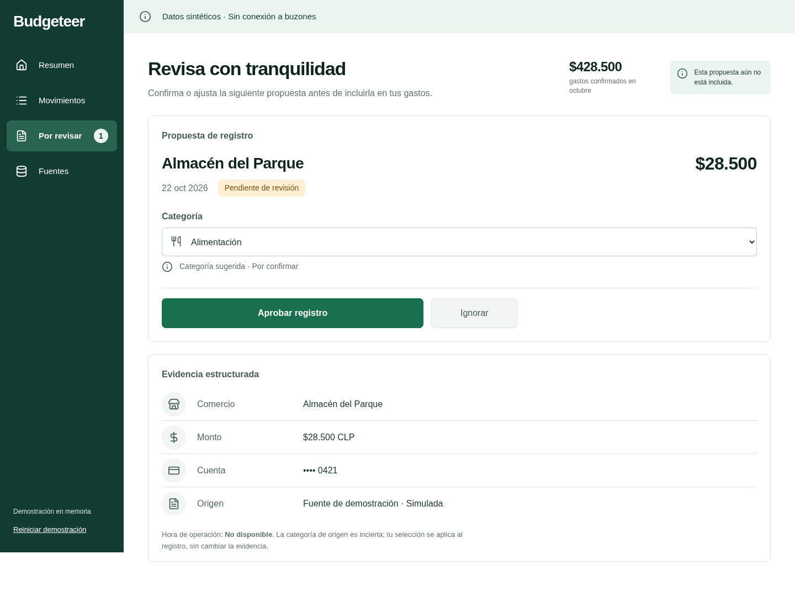
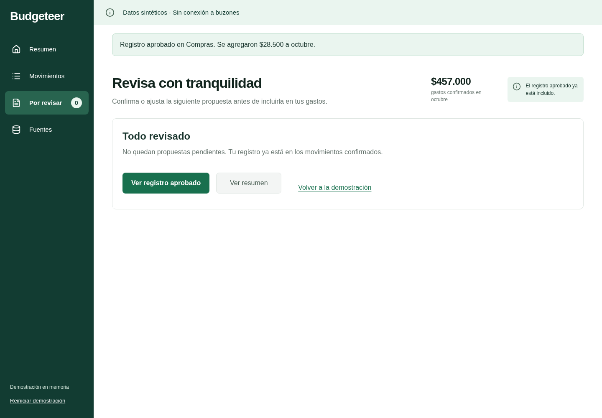
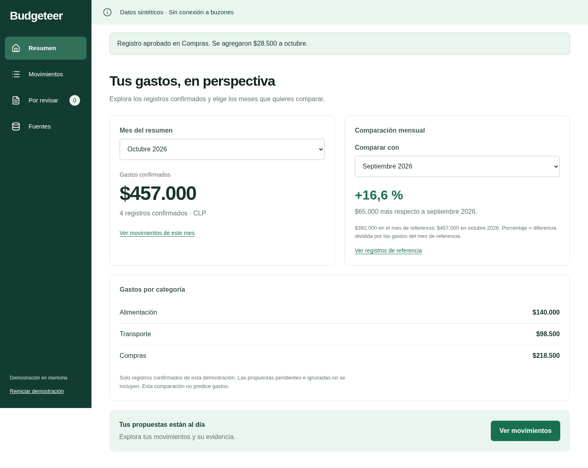
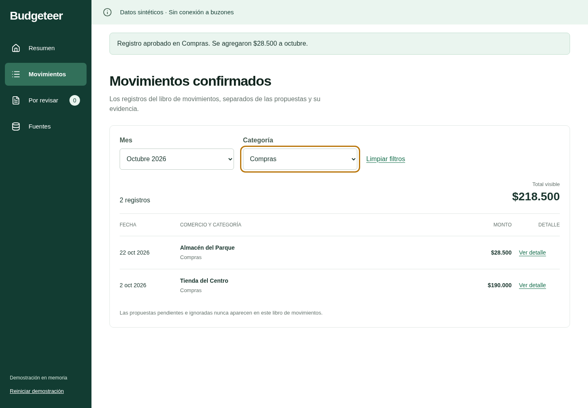
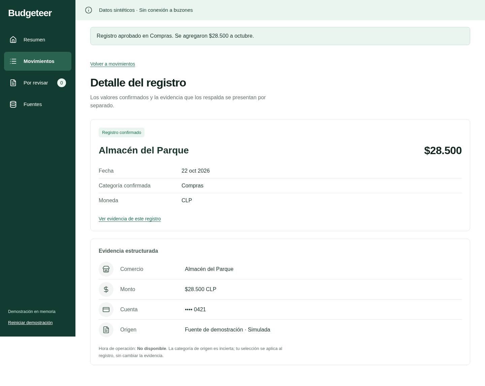
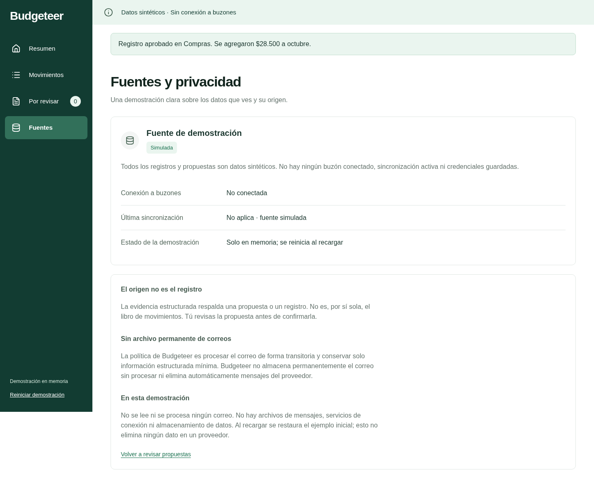
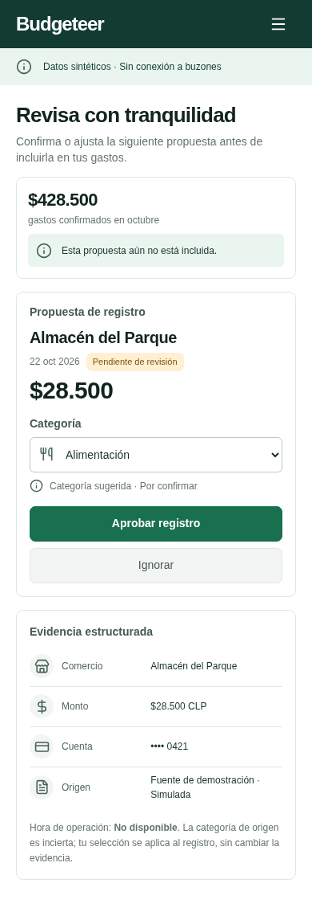
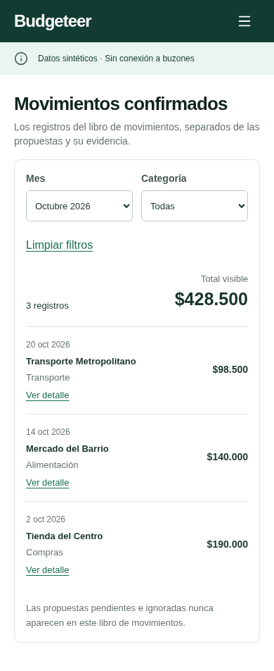
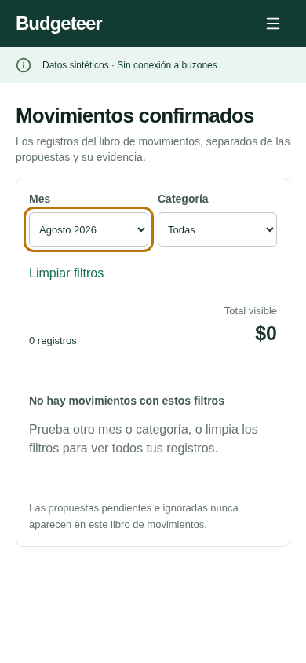

# M1 Overseer flow audit

Status: usable prototype reviewed; final user acceptance pending. This report uses screenshots captured from the running local prototype during this review, not generated concepts. All financial examples are synthetic.

The selected visual target is option 2 with the green revision. Desktop evidence is 1440 × 1000; mobile evidence is 390 × 844, with full-page captures where needed. Chromium was controlled locally through Playwright because the Browser app did not expose a callable browser tool. This establishes local browser evidence; it does not claim Browser-app, remote-hosted, or cross-browser verification.

## Reviewed journey

1. **Inspect a proposal — healthy.** The pending state, category suggestion, excluded-from-total explanation, masked account hint, and unavailable operation time are visible. Evidence is presented separately from the proposal values.

   

2. **Categorize and approve — healthy.** Changing the category to Compras and approving adds one entry, clears the queue, and increases October from $428.500 to $457.000. Confirmation explains the effect and links to the approved record.

   

3. **Explore spending — healthy.** Overview and category totals use the updated ledger; comparison periods and their basis are explicit. A separate interaction check selected the zero-spending baseline and verified that no percentage was invented.

   

4. **Filter the canonical ledger — healthy.** October plus Compras shows the two matching entries and their $218.500 total. Pending and ignored proposals remain excluded. Labels and visible keyboard focus support filter use.

   

5. **Inspect provenance — healthy.** The approved category is shown with the record; minimized evidence remains distinct, including its original uncertainty. The evidence control focuses the evidence heading without losing the record route.

   

6. **Understand source/privacy status — healthy.** The source is explicitly simulated, with no connected mailbox or active synchronization. Copy explains transient email processing, no permanent raw-email archive, and no automatic provider deletion, without pretending those integrations exist in the prototype.

   

7. **Review on mobile — healthy.** Primary actions stack, content wraps, and evidence remains readable without horizontal overflow. Opening the menu and selecting its active route now closes the menu correctly. Ignore and reload were checked independently: ignore leaves totals unchanged; reload restores the pending proposal.

   

8. **Browse on mobile — healthy.** Transactions retain date, merchant, category, amount, and a usable detail link in a stacked layout. Month and category filters remain available.

   

9. **Recover from an empty result — healthy.** The empty state explains the filter outcome, displays zero, and offers a clear filter-reset action. Focus remains visible on the changed filter.

   

## Findings and limits

- Corrected during this review: the skip link unexpectedly changed routes; the evidence anchor replaced the detail route; a table-cell role hid link semantics; and selecting the current mobile navigation route left its menu open.
- Screenshots establish visual hierarchy, wrapping, visible states, and the selected green direction. Interaction assertions establish the state changes described above. Neither alone establishes full accessibility compliance.
- Direct-file launch was blocked by managed Chromium policy (`ERR_BLOCKED_BY_ADMINISTRATOR`); the verified launch path is the documented local HTTP static server.
- Screen-reader behavior, Safari/Firefox, real assistive technology, and device touch behavior have not been validated. Those remain limits rather than claims of conformance.
- The palette is provisional, grounded in the user's mostly-green constraint. Official Budgeteer hex tokens were unavailable. Production schemas, financial interpretation, retention implementation, and integrations remain outside M1.
- No outstanding blocking UX finding was observed in the audited journey. Final product acceptance belongs to the user; GitHub Project status remains manual.

## Design skills used

- Product Design index: route design work and maintain the selected visual target.
- Ideate: three visual options and the selected green revision.
- Image to Code: responsive implementation of option 2 and its working interactions.
- Design QA: compare rendered desktop/mobile output with the selected image.
- Audit: this screenshot-backed flow review and its accessibility limits.

Supporting context skills were User Context and Get Context. Their use does not imply a deployed site or saved external design system.
