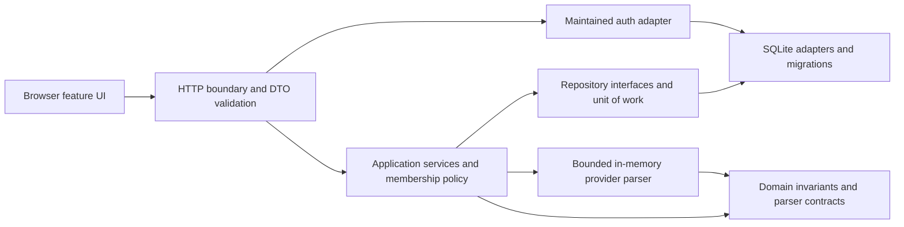
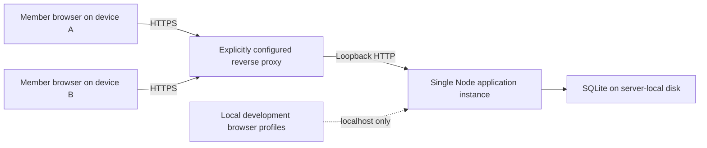
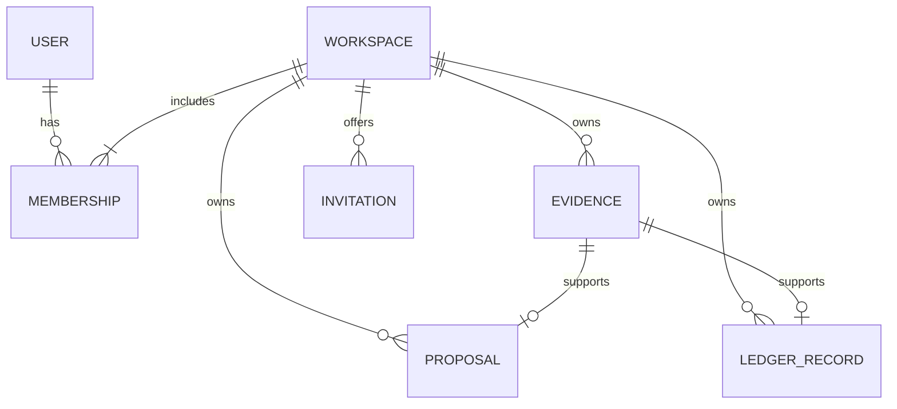

# M2 architecture: shared import, review, and ledger

- Status: architecture draft for independent and user review; no application implementation authorized.
- Approved milestone choices: Node.js, TypeScript and SQLite; generic workspaces; authenticated users sharing records; requested four providers/types; ignored inputs leave no retained data.
- Proposed choices below: module layout, maintained libraries, owner/member policy, sessions, invitation flow, trust/configuration and credential retention. Approval is not implied by this draft.
- Provider support is unverified until example-derived, non-email contracts are reviewed. No real message, private mailbox or financial database was accessed.

## 1. Outcome and boundaries

Two independent application accounts can join one workspace, contribute imports, review proposals and see the same saved ledger/summaries. A third account cannot read or mutate any workspace resource. The application account is distinct from the operating-system account running Node. Generic workspace/member names support any relationship without embedding one in the model.

Preserve M1's green review-first UI, Spanish (Chile), CLP, Santiago dates, keyboard operation and responsive layouts. M1 demo stays isolated from real workspaces; reload/restart never resets saved financial data. M2 provides basic shared membership and authentication now; M6 can extend permission granularity, organization lifecycle and audit capability rather than introduce sharing for the first time.

Use one modular monolith and one local-disk SQLite store. No microservices, message bus, mailbox synchronization, LLM message processing, production hosting choice, secret-provider provisioning or automatic network exposure is introduced. SQLite is a milestone storage choice, not a horizontal-scaling claim.

## 2. Components and allowed dependencies

Frontend feature modules: authentication, workspace/members, import, review, ledger/detail, overview and sources/privacy. Shared UI primitives hold M1 styling and accessibility behavior. A typed HTTP client maps safe DTOs/errors; the browser does not import database models, execute financial authorization, or persist financial caches in local/session storage.

Server modules: transport, auth integration, workspace policy, imports/adapters, review, ledger queries, retention and persistence. Dependencies point inward: HTTP maps requests to use cases; use cases enforce policy/invariants; SQLite implements repository contracts. Domain code does not import HTTP, auth-provider SDKs or SQLite. Avoid a generic repository/event abstraction unrelated to an actual use case.

Proposed transport: Fastify, selected for request schemas/body limits and test injection; exact package/runtime versions remain adoption gates. A maintained MIME library handles decoding; provider adapters consume bounded decoded fields, never a web browser or remote resource fetch. Better Auth is the proposed auth integration, not handmade password/session cryptography. No packages are installed by this document.

Suggested code boundaries are `client/features/*`, `server/http`, `server/auth`, `server/application`, `server/domain`, `server/imports`, and `server/persistence/sqlite`. Business rules stay testable independently of route handlers; migrations and auth-generated schemas have explicit ownership and review.

## 3. Reachability: one app and one shared store

Development: bind loopback and use two isolated browser profiles/accounts against one app/database. This proves membership/contribution semantics; it does not let another household device reach the app. Each device running its own private SQLite file would not be collaboration and is not the design.

Shared operation: an operator deliberately configures one reachable HTTPS origin and a TLS reverse proxy on the same server; proxy traffic reaches only the loopback Node listener. Member devices access that same origin and database. No deployment/provider is selected or configured now. Operator must supply reachable DNS/network path, certificate trust, access/firewall policy and protected local disk; localhost-only testing cannot certify these prerequisites.

Configuration declares `development-loopback` or `shared-https` mode, canonical base URL, permitted Host/Origin and narrowly trusted proxy address. Fail startup if shared mode has HTTP origin, missing secrets, nonlocal Node binding or ambiguous proxy trust. Accept forwarded scheme/host only from the configured proxy and validate against the canonical origin; do not trust arbitrary forwarding headers or wildcard origins. Never auto-open a firewall or expose a LAN port.

Serve client and API from one origin. Use HTTPS secure cookies in shared mode, restrictive content security policy, no remote message content/assets, no financial API caching and `Cache-Control: no-store`. Development may explicitly permit insecure localhost cookies, with a conspicuous mode distinction and startup validation preventing that exception in shared mode.

## 4. Authentication design and alternatives

Recommend password-first Better Auth, framework-agnostic and self-hosted with SQLite. It avoids requiring Google configuration or a Workspace organization before shared review can work. Use the maintained library's credential hashing, session management, CSRF protections and account lifecycle APIs; do not hand-roll login cryptography or assume browser cookie presence establishes authentication.

| Option | Fit and consequence | Proposed disposition |
| --- | --- | --- |
| Email/login identifier plus password | Works without an external identity provider; requires credential, throttling and recovery policy | M2 baseline, pending architecture acceptance |
| Google OIDC | Reduces local password handling; requires app registration, stable HTTPS callback, client secret and identity-linking rules | Future/optional adapter, not required alongside passwords |
| Hosted auth vendor | Adds external service/data/control dependencies | Not selected for this local milestone |

Google extension uses identity scopes only (`openid`, `email`, `profile`), validated issuer/audience/state/nonce/PKCE through the maintained library, and exact registered callback origin. No Gmail/mailbox scopes, domain-only account admission or GSuite-only assumption. Do not auto-link an existing password account solely because an unverified email string matches; account linking requires authenticated confirmation and a reviewed verified-identity rule.

Provision the initial account through an explicit operator setup command calling the auth library, with password from protected interactive input and no credential in process arguments/logs. It may create exactly the initial workspace/owner and closes bootstrap afterward. No permanent bootstrap endpoint or universal admin password. Further enrollment is invitation-gated, with generic sign-in/registration errors; no public account directory or unrestricted shared-mode signup.

Password policy proposal: library-supported slow password hashing (scrypt or Argon2id, version-dependent and benchmarked), at least 12 characters, reasonable maximum input bound without silent truncation, and no reversible password storage. Do not replace a maintained library's hash/version metadata with a custom format. Password changes require current credentials or an explicitly approved operator recovery path, revoke other sessions, and never reveal the old password.

For M2, operator-assisted credential recovery is a documented privileged action through the library, requiring server access; no unauthenticated reset endpoint or email-delivery service is implied. It is a security boundary, not an account-owner identity proof. Automated email verification/recovery and MFA are future decisions; the UI must not call an unverified password identifier a verified email identity.

## 5. Sessions, requests, secrets and abuse limits

On every financial, workspace and membership request, resolve a valid server-side session through the auth library, then authorize current membership. Do not enable a session-cookie cache that delays membership revocation. Browser session cookies are host-only, HttpOnly, SameSite=Lax, Secure in shared mode, with path `/`; use an appropriate host prefix where supported. Do not place bearer credentials in browser storage or API response bodies.

Propose 24-hour idle expiry and seven-day absolute session lifetime; rotate session identifiers on authentication/security changes. Logout revokes that session server-side and clears the cookie. Password changes revoke other sessions. Membership removal revokes workspace access immediately without necessarily destroying the user's sessions for unrelated workspaces. Do not cache membership in a client-supplied session claim.

The exact auth-library version, SQLite adapter, session token storage and revocation behavior must be inspected and contract-tested before adoption. Passwords persist only as slow salted hashes; auth signing/encryption keys live in protected deployment configuration, not the app database, repository or logs. Session tokens are bearer secrets: never log or expose them. Do not claim the library hashes/encrypts stored session tokens without evidence. If its adapter stores usable tokens, require an approved encrypted auth-store/volume design and key management before shared real-data operation; changing auth-library internals to invent token cryptography is not the fallback.

Unsafe requests require a valid same-origin request and the auth library/framework's CSRF protection, including sign-in/logout, invitation acceptance, imports and deletion. CORS is not authorization. Validate canonical Host and Origin on the server, use same-origin anti-CSRF tokens where required, and refuse GET mutation. Limit auth attempts by identifier and trusted client address with persistent bounded counters, generic failure timing/messages and 429 retry guidance; avoid indefinite victim lockout.

Proposed initial limits: five failed sign-in attempts per identifier/address window of 15 minutes; one upload per action, maximum 1 MiB and five seconds parsing time; small bounded concurrent parse queue; JSON bodies separately capped. These are tunable reviewed limits, not denial-of-service guarantees. Raw request/auth/upload bodies are excluded from access/error logs at app and reverse proxy.

## 6. Minimal workspace and membership lifecycle

| Capability | Owner | Member | Nonmember |
| --- | --- | --- | --- |
| Read workspace proposals, ledger, evidence and summaries | Yes | Yes | No |
| Import, review, approve or ignore workspace proposals | Yes | Yes | No |
| Create/revoke invitation and remove another member | Yes | No | No |
| Delete this workspace and its financial data | Yes, deliberate reauthentication/confirmation | No | No |
| Read or mutate a different workspace by guessed ID | Only through membership there | Only through membership there | No |

One owner and zero or more members are sufficient for M2. Create workspace and owner membership atomically. Do not allow removing/leaving the only owner; ownership transfer is a separate owner action with atomic invariants or deferred with a clear refusal. A member may leave; the owner may remove a member. Removal does not erase that contributor's previously reviewed workspace financial records.

An owner creates a one-use, workspace/role-scoped invitation secret with 24-hour expiry, delivers it directly to the intended collaborator outside Budgeteer, and may revoke it. Store only a cryptographic digest of the invitation token. Do not discover accounts by searching email or report whether a login identifier exists. Workspace member listing exposes only that workspace's members and bounded display information.

An authenticated recipient accepts the invite, which atomically consumes it and adds membership. The secret grants the specified membership; it is not proof of an email address or relationship. New-account enrollment may use the same invitation-gated flow but membership is not granted until authentication/enrollment succeeds. Avoid token-bearing URLs in logs: deliver token in a fragment, keep it transient in memory and POST it with CSRF protection; clear it from navigation after acceptance. Exact library integration remains subject to review.

## 7. HTTP/service contracts and error boundary

Representative routes: `/api/session`, `/api/workspaces`, `/api/workspaces/:workspaceId/members`, `/invitations`, `/imports`, `/proposals/:proposalId/approve`, `/proposals/:proposalId/ignore`, `/records`, `/records/:recordId` and `/summary`. Nested resources always include workspace context; pagination/filter bounds and request/response schemas are explicit. Auth routes are owned by the maintained library; application routes do not reimplement them.

Typed service inputs resemble `approve({ actorId, workspaceId, proposalId, expectedVersion, reviewedFields })`, `importNotification({ actorId, workspaceId, boundedBytes })` and `listRecords({ actorId, workspaceId, filters, cursor, limit })`. The actor is derived from the server session, never a request-body user ID. A workspace ID is a requested resource scope, not evidence of authorization.

`WorkspacePolicy.requireMember/requireOwner` consults current membership. Repositories require `workspaceId` for every proposal/evidence/record lookup and update, including summaries and import-fingerprint matches. No unscoped `findById` in financial application paths. Domain validators enforce positive integer CLP amount, bounded labels, known notification type, valid date and incoming/outgoing/unresolved direction; review changes never mutate supporting evidence.

Map expected errors to safe codes: 401 unauthenticated; consistent 404 for inaccessible/missing workspace resources; 409 stale proposal or write conflict; 413 upload too large; 422 unsupported/ambiguous/invalid import; 429 limits; 503 retryable local store busy/unavailable. Do not echo raw MIME, filenames, credentials, SQL text or parser exceptions. Operational logs contain request/error IDs, safe codes and durations rather than financial fields or tokens.

## 8. Data and transaction design

Auth-owned users/accounts/sessions and app-owned workspace/membership/invitation/proposal/evidence/ledger/import-marker tables have separate migration responsibilities in the same protected store. Keep auth-owned schema controlled by the pinned library. Auth tokens/credential hashes never appear in app DTOs. Financial rows carry `workspace_id`, server-generated identifiers, creator/reviewer IDs where useful, timestamps and version fields; contributors are provenance, not owners allowed to bypass shared-workspace policy.

Use foreign keys and composite workspace/resource references so a record cannot attach evidence from another workspace. Uniqueness includes `(workspace_id, import_fingerprint)` for retained pending/approved imports and a unique canonical reference to an approved proposal/import identity. Do not use a sender's message ID as a trusted global identity. Invitations store scoped digests and expiry, with single-use constraints.

Import: authenticate and authorize in an early route hook before consuming the bounded upload stream; disable generic upload-to-disk/body logging middleware. Parse outside the database write transaction, then begin a short transaction, recheck membership, enforce retention and exact-input uniqueness, and atomically insert minimized evidence/proposal/marker. No raw input staging, payload log or attachment/resource fetch. Parser timeout/worker termination releases transient buffers without a durable failed-input record. Exact-input fingerprints are sensitive derived data, not anonymization or semantic deduplication.

Approval: begin short write transaction; recheck current membership and proposal version/state; validate reviewed fields; insert exactly one ledger record referencing immutable evidence; remove pending state and convert its marker to approved; commit. Two concurrent approvals result in one canonical record and one existing-result/conflict response. A membership removal committed first makes approval fail; an approval committed first is a legitimate prior authorized operation. SQLite serializes these writes; middleware-only checks cannot settle the race.

Ignore: in one authorized transaction, delete proposal, its now-unreferenced evidence and import fingerprint. No ignored financial row, fingerprint, tombstone or payload-bearing audit event remains. Consequently, reimporting the ignored bytes may create a fresh proposal; disclose this behavior. This deliberately differs from the earlier replay-marker proposal, per the latest user instruction.

## 9. Retention, deletion and browser isolation

Pending proposals/evidence expire after 30 days; canonical records and their evidence remain until explicit authorized deletion. Apply expiration at reads/import/startup plus a bounded in-process sweep, with tests around cutoff times; expired pending rows never appear solely because a background sweep is late. Remove unreferenced pending fingerprints with their data. Retained approved exact-input markers follow the approved record lifetime. No temporary raw store is proposed.

Workspace deletion is owner-only with recent authentication and explicit confirmation. Transactionally remove only that workspace's financial rows, evidence, markers, invitations and memberships; do not remove other workspaces, global users, auth accounts or the entire SQLite file. Existing sessions remain usable for other workspaces. Operational whole-database wiping and physical secure erasure are outside the user flow; backups require a separate retention/security design and no erasure claim is made about them.

Proposed auth metadata retention: expired/revoked sessions removed within 24 hours; expired/consumed/revoked invitation digests removed within 24 hours; bounded rate-limit rows expire after their window. Remove membership immediately on owner action. Retain credential hashes/global account identity while the account exists; account deletion/recovery and contributor references require explicit lifecycle review rather than cascading workspace financial deletion. No persistent auth-failure payload logs.

On logout, session expiry, member removal and account/workspace switch, clear in-memory queries, selected records, pending uploads, dialogs and cached summaries. Abort in-flight requests and discard late responses whose session/workspace context changed; every request still receives server authorization. Do not reuse a query key without account/workspace scope. Browser back must not reveal old private response content through an app cache or persisted storage; test this separately from server denial.

## 10. Provider and financial semantics boundary

Adapters exist for Banco de Chile, Banco Santander, Banco Estado and MercadoPago only after applicable Debit, Received Payment, Credit Card Purchase and Bank Transfer contracts are known. Provider names alone do not prove sixteen real formats. Examples are forthcoming; this architecture defines seams and synthetic contract tests without fabricating verified support or opening messages. An unsupported/ambiguous family returns a safe result, never guessed financial fields.

A positive CLP amount, notification type and reviewed direction remain separate. Incoming notifications are not automatically income; bank transfers are not automatically expenses; card purchases have their own summary bucket rather than masquerading as bank-account cash outflow. Unresolved direction is explicit and excluded from directional sums. Filters and comparisons preserve the same disclosed type/direction basis. No reconciled balance, transfer matching or semantic duplicate resolution is claimed in M2.

## 11. SQLite operations and deliberate growth seam

Use one app instance on server-local disk, SQLite foreign keys and WAL, bounded connection count, short write transactions, a configured busy timeout (propose five seconds) and bounded retry only for recognized safe operations. Do not hold a write lock during upload parsing, password hashing, HTTP waits or arbitrary user input. Return retryable unavailable/conflict instead of silently dropping a write. WAL sidecars are sensitive and belong to the protected data directory.

Version and review migrations, run them under exclusive startup/maintenance control before accepting requests, verify foreign keys and fail startup visibly on incompatible/corrupt schema. Test migrations on synthetic data and crash rollback; do not silently recreate a failed store. Keep financial migrations and auth-library schema generation ordered and pinned. Backup/restore operations require later explicit design before use with real data.

Index memberships by `(user_id, workspace_id)`, records by `(workspace_id, occurred_at, id)` and relevant type/provider filters, proposals by workspace/state/expiry, and exact-input markers by workspace/fingerprint. Use bounded cursor pagination and aggregated workspace-scoped SQL; do not load an entire ledger into Node to filter it. Monitor safe durations/counts and contention without financial payloads.

Repository contracts isolate application use cases from SQLite details but do not promise database-neutral SQL. A future Postgres move requires deliberate schema/SQL/migration/transaction-semantics work and concurrency tests. SQLite WAL does not permit NFS shared-file use, multiple independent writers across hosts or automatic horizontal replication. Select Postgres or another scaling design when measured single-host constraints justify a separate decision.

## 12. Review gates and verification plan

1. Architecture fitness: dependency checks forbid HTTP/auth/SQLite imports into domain code, frontend DB imports and unscoped financial repository calls; each feature's policy is tested at service and HTTP boundaries.
2. Authentication: correct/incorrect passwords, generic enrollment failures, throttling, secure cookie flags, fixation/rotation, CSRF, logout revocation, idle/absolute expiry and password-change revocation through the actual pinned library.
3. Sharing: two independent accounts join one workspace and both add/review/read the same records after restart. A third user is denied every detail/list/summary/import/member endpoint, including guessed IDs and direct requests bypassing UI.
4. Membership races: remove a member while import/approval runs; prove the transactional membership recheck. Concurrent approval yields one ledger record; cross-workspace evidence/reference injection fails database and application constraints.
5. Privacy/state: construct MIME in memory; test malformed/oversized/timed-out/unsupported input, no raw payloads/headers/filenames/tokens in DB/logs/DTOs, immutable evidence, no ignored marker/tombstone, and reimport-after-ignore behavior.
6. Lifecycle: pending cutoff, session/invitation cleanup, owner-only workspace deletion, unaffected other workspace/accounts, demo isolation, restart persistence, failed writes and schema/migration failure without data replacement.
7. Browser isolation: keyboard/mobile flows, account/workspace switching, stale response cancellation, logout/back navigation, error recovery and no financial/browser bearer storage. Test two isolated contexts, not only switching a displayed username.
8. Topology: shared-mode configuration rejects insecure/misrouted proxy/origin/cookie combinations; remote-device collaboration requires separately configured HTTPS reachability. Local tests do not certify public deployment or full accessibility compliance.

Open decisions for review: adopt/version Better Auth and Fastify; credential/session at-rest mechanism and key management; password/invitation bootstrap/recovery lifecycle; proposed session/invitation/rate limits; owner transfer/account deletion boundaries; supported provider-format contracts and later shared HTTPS operator configuration. Do not create application code until independent review and the user's architecture approval. No new accepted ADR is asserted by this draft.
